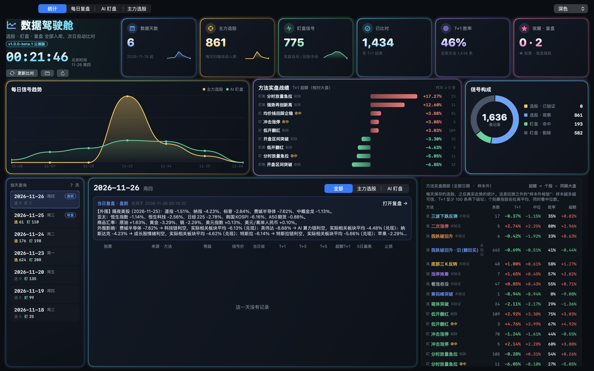
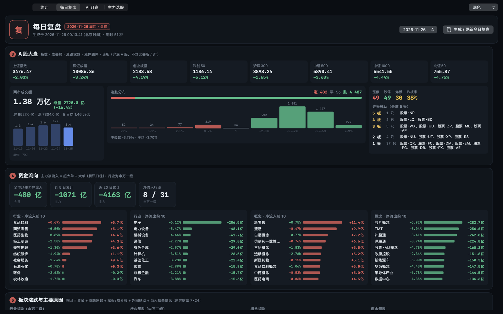
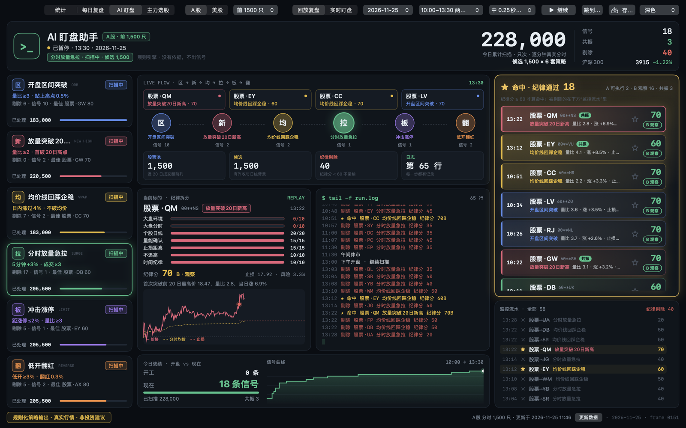
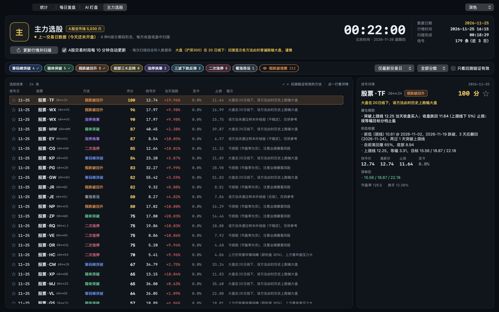

# AI 盯盘助手

一个在**自己电脑上运行**的 A 股 / 美股复盘与盯盘工具：每日复盘、AI 盯盘、形态选股、个股研判，所有结果存进本地数据库，第二天自动比对涨跌，用真实数据检验每种方法到底有没有用。

**免费 · 开源 · Mac / Windows 都能用 · 数据只存在你自己的电脑上**

> 当前版本：**v1.0.0-beta.1（公测版）**　　反馈问题时请注明版本号
>
> ⚠️ 本项目是个人学习与研究工具，所有信号都是规则的机械输出，**不构成任何投资建议**，不推荐任何具体股票。股市有风险。

---

## 界面

| 统计（数据驾驶舱） | 每日复盘 |
|---|---|
|  |  |
| **AI 盯盘** | **主力选股** |
|  |  |

截图为演示模式，个股名称和代码已打码。界面支持 **深色 / 浅色 / 跟随系统** 三种配色。

## 功能

| 功能 | 做什么 |
|---|---|
| **统计** | 本地数据库总览：每天的选股、盯盘信号、复盘、研判记录按天查询；每种方法之后 T+1 / T+3 / T+5 的真实涨跌和相对大盘的超额（样本外检验）；收藏；按天 / 周 / 月 / 年删除旧数据 |
| **每日复盘** | 外围市场（隔夜美股、亚太、商品汇率）→ 外围对 A 股哪些板块产生了影响（自动验证）→ 成交额、涨跌家数、涨停与连板 → 主力资金流向 → 板块涨跌原因与相关快讯 → 昨日选股比对 → 汇总与明日要点 |
| **AI 盯盘** | 6 套日内策略逐分钟扫描 A 股或美股（前 1500 / 前 3000 / 全市场），每条信号带触发理由、止损和纪律分；可回放近 5 个交易日，也可交易时段实时盯盘并弹出提醒 |
| **主力选股** | 8 种 K 线与筹码形态扫描全部 A 股，每种方法都有近两年的全市场回测结论；“假跌破观察”名单 |
| **个股研判** | 输入代码，看趋势、买卖区间、止损、仓位测算、同业对比和风险；每次研判自动记录，可收藏 |

程序开着时会自动：9:00 生成盘前复盘、15:35 生成收盘复盘、收盘后比对之前的选股、实时盯盘时保存信号。

## 下载

在本仓库的 **[发行版（Releases）](https://github.com/sinowjy-ux/ai-dingpan-assistant/releases/latest)** 页面下载最新版本：

| 文件 | 适用 |
|---|---|
| `AIDingPan_v1.0.0-beta.1_mac.dmg` | macOS 14 及以上，Apple 芯片和 Intel 都支持 |
| `AIDingPan_v1.0.0-beta.1_Windows.zip` | Windows 10 / 11（64 位，含 ARM 版） |
| `SHA256SUMS.txt` | 校验值 |

两个安装包都**自带运行环境，不需要另外安装 Python**。下载后可以核对校验值，确认文件没有被改动：

```bash
shasum -a 256 AIDingPan_v1.0.0-beta.1_mac.dmg          # Mac 终端
```

```powershell
Get-FileHash AIDingPan_v1.0.0-beta.1_Windows.zip      # Windows PowerShell
```

## 安装与首次使用

**Mac**

1. 打开 dmg，把“AI盯盘助手”拖进“应用程序”。
2. 第一次打开会提示“无法验证开发者”（个人开源软件没有付费的苹果签名）：到 **系统设置 → 隐私与安全性**，点 **仍要打开**。
   或在终端执行一次：`xattr -dr com.apple.quarantine /Applications/AI盯盘助手.app`

**Windows**

1. 把 zip **解压**到普通文件夹（如 `D:\AI盯盘助手`），不要在压缩包里直接运行。
2. 双击 **启动 AI盯盘助手.bat**，会用 Edge 打开一个应用窗口。如果提示“Windows 已保护你的电脑”，点 **更多信息 → 仍要运行**。
3. 要完全退出：点界面右上角“退出程序”，或双击 **退出 AI盯盘助手.bat**。

**第一次启动**会自动下载全部 A 股近 5 年日 K（约 10–25 分钟，中途关闭下次会接着下载），统计页顶部显示进度。期间可以先用“每日复盘”。

详细说明见 [docs/说明书.html](docs/说明书.html)（下载到本地用浏览器打开），或按章节阅读 [docs/manual](docs/manual)。

## 这些方法有效吗？

**还不知道，这正是这个项目想一起验证的。**

主力选股的 8 种方法都用 2025 年 1 月至今、约 5000 只 A 股做了全市场回测，按“每笔收益 − 同期全市场平均”计算超额，2025、2026 两年分开看，两年都跑赢才算“有效”：

| 方法 | 回测结论 |
|---|---|
| 筹码峰突破、箱体突破、假跌破回升 | 有效，但**只在沪深300 位于 20 日线上方时**成立 |
| 二次涨停、涨停换筹、三波下跌反弹、底部三K反转 | 不稳定（一年跑赢、一年跑输） |
| 看涨吞没 | 无效 |

回测只代表历史。软件会把每天的选股和盯盘信号存下来，之后自动比对真实走势；统计页的“方法实盘跟踪”就是持续的样本外检验。样本越多越可信，个别暴涨股会拉高平均值，要同时看中位数。

## 参与验证与反馈

- 发现问题或有改进想法，请在本仓库的 **Issues** 里提出，按 [docs/反馈模板.txt](docs/反馈模板.txt) 写明：**版本号**、电脑系统、哪个页面、发生了什么。
- 如果你积累了某个方法的实盘统计（统计页截图即可，请打码个人信息），也欢迎分享，一起看哪些规则需要调整。
- 请不要在反馈里讨论具体个股的买卖。
- 每个版本改了什么见 [docs/更新日志.md](docs/更新日志.md)。

## 从源码运行（开发者）

需要 Python 3.10+ 和 numpy：

```bash
pip install numpy
python3 server.py            # 浏览器打开 http://127.0.0.1:8765/dashboard.html
```

Mac App（SwiftUI，只需要 Xcode 命令行工具）：

```bash
cd macapp && zsh build.sh    # 生成 macapp/build/AI盯盘.app，使用上一级目录的 server.py 作为后台
```

目录说明：

| 目录 / 文件 | 内容 |
|---|---|
| `server.py` | 本地后台（网页界面与所有接口） |
| `monitor/` | AI 盯盘：分时数据、6 套策略、纪律分、回放与实时 |
| `screener/` | 主力选股：筹码分布、8 种形态、回测、扫描 |
| `journal/` | 本地数据库、每日复盘、选股比对 |
| `static/` | 网页界面（Windows 版和浏览器使用） |
| `macapp/` | Mac App 源码 |
| `docs/` | 说明书、更新日志、反馈模板、截图 |

## 数据来源与隐私

- 行情来自腾讯财经、新浪财经、东方财富、Yahoo Finance、Nasdaq 等公开接口，可能延迟、缺失或出错；数据版权归各提供方所有，仅供个人学习研究，请勿商用或二次分发。国内网络连不上 Yahoo 时会自动改用腾讯数据。
- 所有数据（数据库、行情缓存、收藏、记录）只保存在你自己的电脑上，软件不收集、不上传任何个人信息。

## 免责声明

本软件免费、开源，作者**不收费、不带单、不提供荐股或代客理财服务，也不建任何收费群**。任何以本软件名义收费、荐股、拉人投资的行为都与作者无关，请注意防范诈骗。软件输出不构成投资建议，投资决策和盈亏由使用者自行负责。

“早晨之星”“阳包阴”等是公开的通用技术分析术语；其余方法名称为本软件对形态的描述性命名。

## 许可证

[MIT License](LICENSE)。第三方组件：Python（PSF License）、NumPy（BSD）、tzdata（Apache 2.0）、Apache ECharts（Apache 2.0）。
